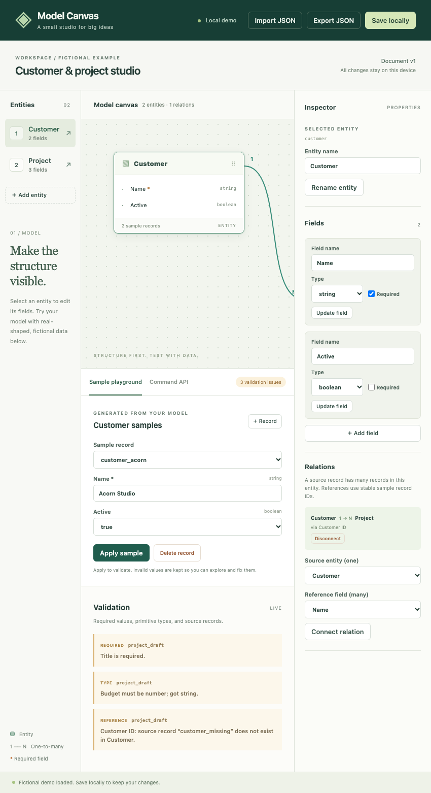
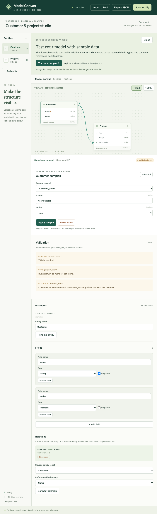
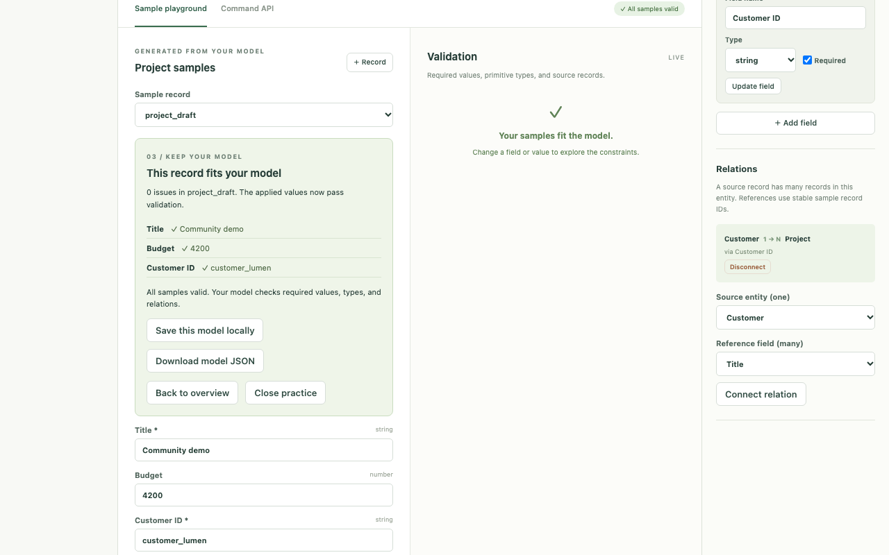
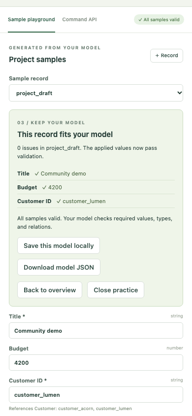

# Try the model / モデルを試す

Use `npm run dev -- --port 14335` and open <http://127.0.0.1:14335/>. No API key is needed. All shown data is fictional. / 上記コマンドで起動しURLを開きます。APIキー不要、画像はすべて架空データです。

1. **See / 全体を見る** — The quick guide explains the three deliberate errors. **Fit all** shows Customer, Project, and their relation; **100%** lets you read or move cards at full size. / ガイドで学習用の3件のエラーを確認。全体表示と100%表示を切り替えても保存座標は変わりません。
2. **Try / 試す** — Choose **Try the example**. It selects `project_draft` and focuses Title, without modifying any values. / 値を変更せず練習レコードのTitleへ移動します。
3. **Fix / 修正する** — Enter Title `Community demo`, Budget `4200`, Customer ID `customer_lumen`. Choose **Apply sample**. The guide shows zero issues and the applied values. / 必須・数値型・参照先の3件を入力で解消し、適用結果を確認します。
4. **Keep / 保存する** — Choose **Save this model locally** or **Download model JSON**. Local saving is explicit. Shared-mode edits save after server acknowledgement; only download is offered there. / ローカルでは明示保存。共有モードではサーバー保存成功後に完了を表示し、ダウンロードへ案内します。
5. **Explore / 続ける** — **Back to overview**, **Close practice**, and **Show quick guide** only change navigation. Select any diagnostic to focus its exact field. Unapplied inputs remain when switching records, entities, or tabs. / 戻る・閉じる・再表示・診断からの移動で入力を破棄しません。

A previously saved or shared document is never reset by the guide. It offers general instructions if the practice schema/record is absent. To reproduce the original three errors, use a fresh isolated browser context or a new local origin with the fictional demo; do not reset someone else's saved document. / ガイドは保存済み・共有ドキュメントを初期化しません。改善前後の再現には分離ブラウザまたは新しいローカルoriginの架空デモを使用します。

## Before and after / 改善前後

850 × 850, original parent commit: Project was outside the canvas viewport and diagnostics selected only the entity. / 親コミットではProjectが見切れ、診断からはEntityだけを選択していました。

850 × 850 after: the complete relation and both cards are visible, with a direct practice entry. / 改善後は2カード・関係線と練習への入口を表示します。

1280 × 800 after applying the three values: the result receives focus and shows the values that pass. / 修正適用後は結果にfocusし、検証を通った値を表示します。

390 × 844 completed view: controls wrap within the viewport. The rest of the model and inspector remain available by vertical scrolling. / 390pxでもボタンが収まり、モデルとインスペクターへは縦スクロールで移動できます。

